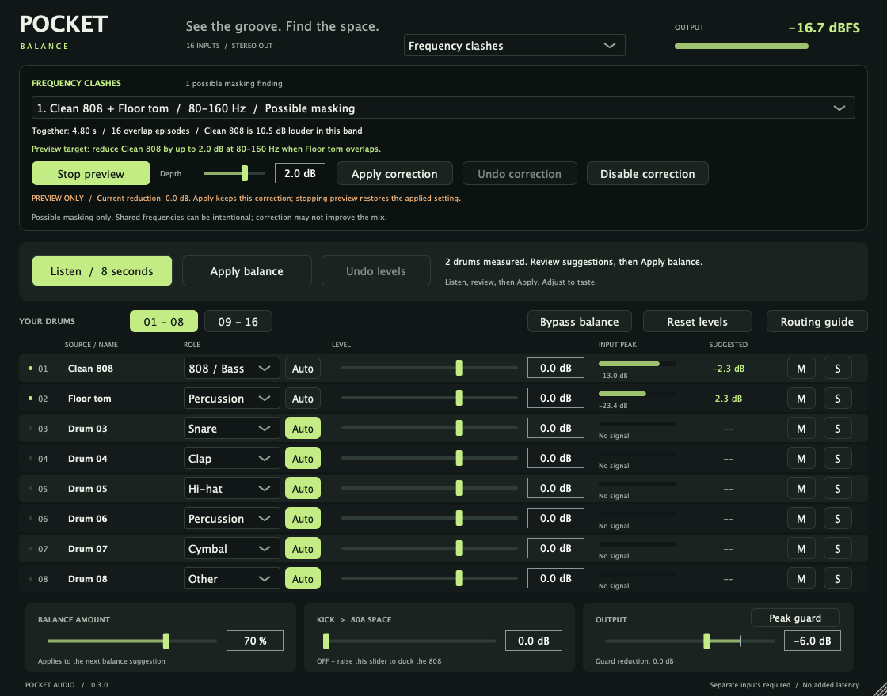

# Pocket Balance

A native drum mixer for FL Studio and other hosts with multiple plugin inputs.

**Version 0.3.0:** 16 separate drum inputs, one stereo output, an eight-second listen-and-balance workflow, and a live waveform display.
The plugin suggests levels. You keep control of the mix.

Download the [0.3.0 prerelease for Mac or Windows](https://github.com/dylanmccavitt/pocket-balance/releases/tag/v0.3.0).
Live FL Studio verification remains incomplete; see the [validation record](docs/validation-0.3.md).



## What it does

- Handles up to 16 mono or stereo sources per instance.
- Suggests conservative levels for kicks, 808s, snares, claps, hats, percussion, cymbals, and other sounds.
- Provides manual gain, mute, solo, input meters, and editable names for each source.
- Measures repeated frequency overlap between simultaneously active drums.
- Offers a reversible preview and one optional dynamic frequency correction, limited to 3 dB.
- Offers adjustable kick-to-808 ducking.
- Displays the kick against the 808/bass before and after ducking, with reduction information, or shows the output or an individual input lane.
- Provides 1-, 2-, and 4-second display windows, display zoom, and Freeze for inspecting transients.
- Protects the output with a stereo-linked sample-peak guard.
- Saves settings with the DAW project and supports host parameter automation.
- Adds no latency.

Each drum needs a separate plugin input. A stereo loop or summed drum bus cannot provide independent drum controls.
Use additional instances for more than 16 sources. Each instance balances its own group.

## Build and verification status

Mac VST3, Audio Unit, and standalone targets are provided. The Mac build targets Apple Silicon and Intel.
Windows VST3 and standalone targets use the same source, with a native Windows build script.
Version 0.3.0 passes native Mac universal and Windows x64 builds, with four CTest suites on each platform.
The Mac VST3 and AU also pass pluginval strictness 5.
See [validation details](docs/validation-0.3.md) and [GitHub Actions](https://github.com/dylanmccavitt/pocket-balance/actions) for platform results and limits.
The standalone application is for development and audio-interface inputs; it does not receive tracks from another DAW.

Processor tests cover stereo and mono inputs, disabled buses, summing, mute, solo, bypass, capture, state recall, and undo.
They exercise 44.1, 48, and 96 kHz with varying buffer sizes.
These tests do not establish compatibility with every DAW or replace listening tests in FL Studio.

## Frequency clashes

Select **Frequency clashes** in the analysis-view menu, then play a representative loop and press **Listen / 8 seconds**.
The same capture supplies level suggestions and frequency findings. Analysis itself changes no audio.

1. Select a finding and read the source pair, frequency band, overlap duration, and relative level.
2. Check which source would be reduced and which source it would protect.
3. Set a depth between 0 and 3 dB. The starting proposal is 2 dB.
4. Click **Preview** to hear the reduction temporarily.
5. Stop Preview to compare, or click **Apply correction** to retain it.
6. Use **Undo correction** to restore the previous correction, or **Disable correction** to switch it off.

Only one correction can be applied at a time. Applying another replaces it; cuts do not stack.
Preview is temporary and is never saved. Applied settings are saved in the DAW project.
Closing the editor, changing analysis views, starting another Listen, or using internal bypass ends Preview.
Internal bypass disables both kick ducking and frequency correction while keeping routed inputs audible.

The detector measures stereo energy in eight octave-wide frequency bands from 40 Hz to 10.24 kHz.
It compares sources in simultaneous 20 ms frames, after lane levels and kick ducking, before frequency correction and output trim.
A report requires substantial coactive band energy and repeated overlap, or sustained overlap of at least one second.
It reports the strongest qualifying band for each source pair, up to eight findings.
A directional proposal requires one source to be at least 3 dB louder in that band. Equal-level findings are informational.
The frequency ranges are approximations from overlapping filters, not surgical boundaries.

The correction reduces the louder source near the selected band center while the protected source is active there.
It uses stereo-linked detection, a bell-shaped cut, a smoothed transition, and no lookahead.
**Overlap is evidence of possible masking, not proof of a bad mix.** It does not judge genre, groove, or creative intent.
Listen and compare before keeping a correction. Small level changes can also solve a clash.

Changing lane gain, role, mute, solo, connections, or kick ducking makes the findings stale.
**Apply balance first, then Listen again** before previewing a frequency correction.
Changes in upstream samples, effects, or routing may not be detectable by the plugin; capture again after those changes.
A new capture can evaluate the current balance but does not automatically replace an applied correction.
Toms use the **Percussion** role in this version.

## Install on Mac

1. Build or obtain the Mac package for the version you intend to use.
2. Copy `Pocket Balance.vst3` to `~/Library/Audio/Plug-Ins/VST3/`.
3. Optionally copy `Pocket Balance.component` to `~/Library/Audio/Plug-Ins/Components/`.
4. In FL Studio, open **Options > Manage plugins**.
5. Select **Find installed plugins**.
6. Load **Pocket Balance** as an effect on an empty Mixer track.

Use VST3 for the FL Studio routing instructions below.
Local development builds are not Apple-notarized releases.

## Install or update on Windows

The standard Windows VST3 installation folder is `C:\Program Files\Common Files\VST3\`.
Copy the entire `Pocket Balance.vst3` bundle, including its `Contents` directory.
Use only one installed copy of Pocket Balance in FL Studio's search paths.

After building and validating this update, save the FL Studio project and close FL Studio. Updating this system folder requires administrator permissions.
The included `scripts/Deploy-Windows.ps1` refuses to run while FL Studio is open; it does not close the host or save projects automatically.
It stages and hash-checks the new bundle, preserves the complete previous installation in a uniquely named folder under `backups/`, and then replaces the installed bundle.
The script reports both the installed path and the backup path. It does not delete the previous version.
Reopen FL Studio and scan plugins if needed. Version 0.3.0 retains the same plugin identity so it updates existing instances.

```powershell
# From an elevated PowerShell window:
.\scripts\Deploy-Windows.ps1
```

## Connect drums in FL Studio

1. Put each drum on a separate Mixer track.
2. Create an empty Mixer track named **Pocket bus**.
3. Insert **Pocket Balance VST3** on that bus.
4. Route only the first drum normally to the Pocket bus.
5. Disable that drum's direct send to Master.
6. Send every other drum to Pocket bus with **Sidechain to this track**.
7. Disable each source's direct Master send.
8. Open the plugin Wrapper settings, then **Processing > Connections**.
9. Keep **Drum 01** connected to the main input containing only the first drum.
10. Map each remaining source to a different input, **Drum 02** through **Drum 16**.
11. Explicitly disable every unused input connection. Merely leaving a connection at its default mapping can feed duplicate audio into other lanes. In the wrapper, turn off **Process inactive inputs and outputs** as well.
12. Keep Pocket bus routed to Master.

Play one source at a time. Exactly one input meter should respond for that source.
If input 01 shows the whole kit, several normal sends still feed the main input.
If the sound doubles, check direct Master sends and other parallel routes.
Keep the bus's host wet control fully wet. Parallel dry mixing can duplicate the first source.

Image-Line documents auxiliary routing in the [Wrapper manual](https://www.image-line.com/fl-studio-learning-content/fl-studio-online-manual/html/plugins/wrapper.htm).
The plugin cannot create these host routes automatically.
Other DAWs must expose multiple auxiliary input buses. Routing support varies by host.

## Source labels and roles

FL Studio's VST3 connections do not supply routed Mixer-track or sample names to this plugin.
Name the lanes with the saved **Source** labels so they match your routing.
The **Auto role from label** option can suggest a musical role from a recognizable label; you can choose a role manually to override it.
Matching uses whole words and ignores case. A specific label such as `808 Clap` is treated as a clap; unknown or conflicting labels do not force a new role.
Labels and musical roles are separate from the host input numbers, which stay fixed.

## Read the waveform display

The live display is an observation tool; changing its controls does not change gain, ducking, audio timing, or plugin latency.
It keeps a bounded recent history rather than recording a file.

- **Kick + 808:** inspect the kick against the 808/bass before and after ducking and follow the reduction indication. Assign the correct roles to the input lanes first; both bass traces already include its fader level.
- **Drum mix or a lane:** switch to the final stereo output or an individual lane after its level and ducking to inspect a specific source.
- **1 / 2 / 4 seconds:** choose a short window for transients or a longer window for a phrase.
- **1x / 2x / 4x / 8x height:** enlarge quiet waveforms on screen without raising their audio level. A trace reaching the plot edge at high zoom does not mean the audio is clipping.
- **Freeze:** hold the displayed history for inspection while audio continues normally.

The graph is a compact waveform overview, not a sample-accurate editor, spectrum analyzer, or automatic correction tool.
Host tests cover dropdown changes and saved display settings.

## Balance a loop

1. Double-click each source name to label it.
2. Select the correct role for each drum.
3. Play a representative loop that includes all drums.
4. Press **Listen / 8 seconds**.
5. Review the **Suggested** column.
6. Adjust **Balance amount** to scale the proposed levels.
7. Press **Apply balance**.
8. Adjust the faders by ear.

The suggested numbers are absolute fader settings, not additional gains.
Apply replaces the faders for measured sources. Silent sources keep their current levels.
Repeated Apply does not accumulate gain.
Balance amount affects the next Apply, not gains already applied.
Listen again after changing samples, upstream effects, source levels, or routing.

**Undo levels** restores the previous fader values from Apply or Reset.
**Reset levels** resets faders, mute, and solo. Undo restores faders only.
**Bypass balance** uses unity source gains and disables ducking while continuing to mix all connected inputs.
Output trim, peak guard, mute, and solo remain active during comparison.
Bypass balance is not loudness-matched. A louder version can seem better.

Use **Kick > 808 space** to reduce 808/Bass sources when audible Kick sources hit.
Zero disables ducking. Attack is 1 ms; release is 90 ms.
The selected amount is reached when the kick detector reaches approximately -12 dBFS.

Output starts at -6 dB to allow room when sources combine.
Peak guard limits sample peaks to -1 dBFS with immediate attack and an 80 ms release.
Heavy reduction can change transients. Lower Output if the guard works constantly.
This is not a true-peak limiter or an automatic EQ, and it cannot guarantee a particular mix sound.

Use the internal **Bypass balance** button for an audible before/after check.
Turning off the plugin in FL Studio can skip the plugin entirely and drop its sidechain inputs from the mix.
The plugin cannot fix that host power-off behavior.
When a host calls the plugin's own bypass callback instead of skipping it, that callback sums enabled sources at unity and disables output trim and guard, which can be louder.

## How suggestions work

Analysis happens before the plugin's faders.
The engine measures stereo energy in 20 ms windows.
It ignores windows below -50 dBFS and tails more than 18 dB below the loudest window.
A source needs at least 50 ms of retained activity. A balance needs at least two measured sources.

The reference uses the median active level after subtracting each role's offset.
Offsets are musical starting points, not objective standards:

| Role | Relative active level |
| --- | ---: |
| Kick | 0 dB |
| 808 / Bass | -2 dB |
| Snare | -1 dB |
| Clap | -3 dB |
| Hi-hat | -10 dB |
| Percussion | -6 dB |
| Cymbal | -9 dB |
| Other | -4 dB |

Suggestions are bounded to ±12 dB before the amount control.
Positive suggestions also respect an individual-source peak allowance of -3 dBFS.
This allowance is not a guarantee for the summed mix; the output guard handles combined sample peaks.
The engine preserves timing and stereo position. It does not detect drum roles automatically.

## Build from source

Requirements: CMake 3.22+, C++17, and an Apple or Microsoft native C++ toolchain.
JUCE is pinned to 8.0.15. Set the `POCKET_JUCE_SOURCE_DIR` CMake cache path to reuse an existing JUCE 8.0.15 checkout without copying or downloading it.
If no external path is supplied, CMake uses a bundled `third_party/JUCE-8.0.15` folder when present, otherwise a SHA-256 verified download.

Mac:

```sh
cmake -S . -B build -G Ninja -DCMAKE_BUILD_TYPE=Release '-DCMAKE_OSX_ARCHITECTURES=arm64;x86_64' -DCMAKE_OSX_DEPLOYMENT_TARGET=11.0
cmake --build build --parallel 6
ctest --test-dir build --output-on-failure
```

Windows x64:

Install Visual Studio 2022 Build Tools with **Desktop development with C++** and CMake.
Run `scripts/Build-Windows.cmd` from the extracted source folder.
The script locates CMake on PATH or inside Visual Studio Build Tools, builds the plugin, and runs CTest.
It does not install the plugin, close FL Studio, or package an unvalidated release.
It accepts `-JuceSourceDir`, `-BuildDirectory`, `-Configuration`, `-Parallel`, and `-CMakePath` arguments.

To reuse an existing JUCE checkout:

```powershell
.\scripts\Build-Windows.cmd -JuceSourceDir "C:\path\to\JUCE-8.0.15"
```

Equivalent commands:

```powershell
cmake -S . -B build-windows -G "Visual Studio 17 2022" -A x64 -DPOCKET_JUCE_SOURCE_DIR="C:\path\to\JUCE-8.0.15"
cmake --build build-windows --config Release --parallel 4
ctest --test-dir build-windows -C Release --output-on-failure
```

The source includes a GitHub Actions workflow for native Mac and Windows builds.
Check the Actions results for the commit you intend to use.

DSP-only tests need no JUCE dependency:

```sh
cmake -S . -B build-dsp -DPOCKET_BUILD_PLUGIN=OFF
cmake --build build-dsp
ctest --test-dir build-dsp --output-on-failure
```

Source: `Source/`. Tests: `Tests/`. Build outputs: `build/PocketBalance_artefacts/Release/`.
See `THIRD_PARTY.md` for dependency notices and distribution considerations.

## License and source

Copyright 2026 Pocket Balance contributors. Licensed under **AGPL-3.0-only**, without warranty.
See [LICENSE](LICENSE) and [THIRD_PARTY.md](THIRD_PARTY.md).
Source and version history: https://github.com/dylanmccavitt/pocket-balance

After the build and tests pass, run `python scripts/Package.py --build build --output package`.
The package contains VST3/AU bundles, license notices, and complete corresponding source, including the pinned JUCE dependency.
Use `--juce /path/to/JUCE-8.0.15` when the build used an external JUCE checkout.
